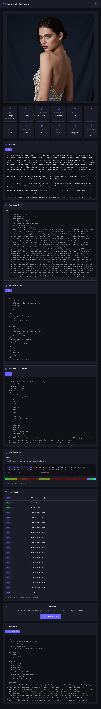

# Snitch Shot

**See everything about your image — instantly, privately, in your browser.**

Drag an image. Get every detail. No uploads, no servers, no tracking.

👉 **[Try it now](https://kibotu.github.io/image-meta-data-viewer/)**

---

## Why This Exists

Every day, photographers, designers, developers need to answer simple questions about images:

- *"Is this image really 300 DPI or did someone lie?"*
- *"What camera took this photo?"*
- *"Why does this PNG look different on my monitor?"*
- *"Is this file actually a JPEG or did someone rename it?"*
- *"What prompt was used to generate this AI image?"*

Existing tools are either **desktop apps you need to install**, **online services that upload your files to who-knows-where**, or **command-line tools** that require technical knowledge.

Snitch Shot solves this with a **single webpage** that runs entirely in your browser. Your image never leaves your computer.

## Feedback database setup

The app sends only the star rating and optional review text to Supabase. Create the `feedback` table in the Supabase SQL Editor with:

```sql
create table public.feedback (
	id bigint generated by default as identity primary key,
	rating smallint not null check (rating between 1 and 5),
	review text,
	created_at timestamptz not null default now()
);

alter table public.feedback enable row level security;

create policy "Anyone can submit feedback"
on public.feedback
for insert
to anon
with check (true);
```

## Features

### At a Glance
- **Drag & drop**, paste, or browse — whatever is fastest
- **100% client-side** — your files never leave your browser
- **Works offline** once loaded
- **Mobile-friendly** — inspect images on your phone
- **Zero install** — just open the URL
- **Privacy warning** — highlights photos containing GPS location metadata
- **Export tools** — copy or download metadata as JSON or text
- **Metadata removal** — download a browser-re-encoded copy without metadata
- **Photo comparison** — inspect two images side by side
- **Dark mode** — switch and remember your preferred theme



### What You'll See

| Section | What It Tells You |
|---------|-------------------|
| **Image Preview** | Full-resolution preview of your image |
| **Quick Facts** | File size, dimensions, megapixels, aspect ratio, DPI, color space, bit depth, format, orientation |
| **Camera Details** | Camera model, lens, and capture settings (ISO, aperture, shutter speed), plus focal length, flash, and GPS location |
| **AI Generation** | Prompts, workflows, and generation parameters from ComfyUI, Stable Diffusion, and other AI tools |
| **PNG Details** | Bit depth, color type, compression, filter, interlace — straight from the IHDR chunk |
| **Embedded Metadata** | EXIF, XMP, IPTC, ICC profiles, PNG text chunks — everything hidden inside |
| **PNG Chunks** | Every chunk in the file with type, size, and plain-English labels |
| **Raw JSON** | All metadata as copyable JSON for technical workflows |

### Supported Formats

JPEG, PNG, WebP, GIF, TIFF, HEIC, AVIF, BMP, SVG, ICO

### Special Support

- **ComfyUI** — extracts prompts and full workflow JSON from `tEXt` chunks
- **Stable Diffusion** — reads `parameters` text chunks
- **Apple screenshots** — surfaces UserComment and display ICC profiles
- **ICC profiles** — full color profile breakdown including matrix columns, TRCs, and chromatic adaptation

## How to Use

1. **Open** [the live site](https://kibotu.github.io/image-meta-data-viewer/)
2. **Drop** an image onto the page (or click to browse, or paste with Ctrl/Cmd+V)
3. **Explore** every detail about your image

That's it. No sign-up. No configuration. No waiting.

## For Developers

### Self-Host

The entire app is a single `index.html` file. Drop it on any static file server:

```bash
# With Python
python3 -m http.server 8000

# With Node.js
npx serve .

# With PHP
php -S localhost:8000
```

### URL Parameter

Load an image from a URL directly:

```
https://kibotu.github.io/image-meta-data-viewer/?url=https://example.com/photo.jpg
```

> Note: The image URL must allow CORS for client-side fetching.

## Privacy

**Your image never leaves your computer.** All parsing happens in your browser using JavaScript. No data is sent to any server. No cookies. No analytics. No tracking.

## Built With

- [exifr](https://github.com/MikeKovarik/exifr) — Blazing fast EXIF/IPTC/XMP/ICC parser
- Pure HTML, CSS, and JavaScript — no build step, no framework

